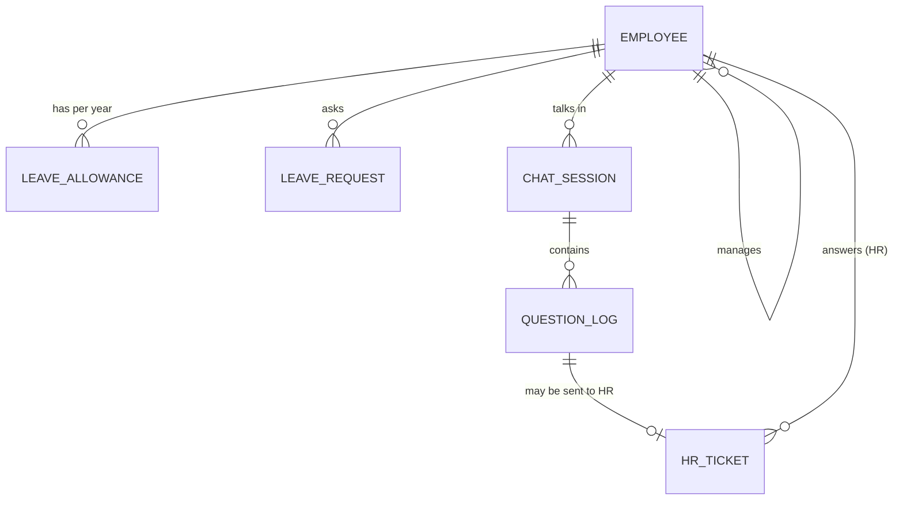
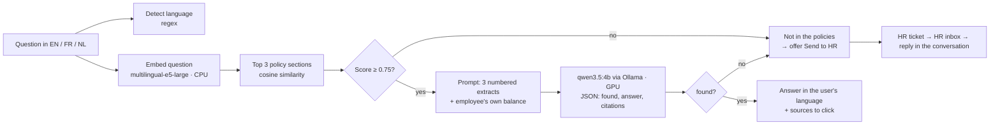

# Corvalis · Leave & availability + rules assistant

A small internal web app for **Corvalis**, a fictional engineering consultancy (about 50 people in Brussels and Liège).
It solves two related problems from the brief:

- **P8 Leave and availability.** Employees request leave online and managers approve it in one click. Everyone shares one calendar, so a site visit is no longer planned with someone who is away.
- **P1 Questions about internal rules.** A local AI assistant answers questions about the five Corvalis policies in **English, French or Dutch**, and shows which rule it used. When the rules don't cover a question, it is sent to HR in one click, and HR's answer comes back in the same conversation.

Everything runs on the laptop. There is no API key and no paid service: the AI model runs locally with Ollama.

---

## Contents
1. [The problem and why](#1-the-problem-and-why)
2. [What the app does](#2-what-the-app-does)
3. [How to run it](#3-how-to-run-it)
4. [Project structure](#4-project-structure)
5. [Data model](#5-data-model)
6. [Leave rules](#6-leave-rules-from-docsleavemd)
7. [The assistant pipeline (RAG)](#7-the-assistant-pipeline-rag)
8. [API](#8-api)
9. [Security](#9-security)
10. [Tests](#10-tests)
11. [Work report](#11-work-report)
12. [What's left out, what doesn't work, what's next](#12-whats-left-out-what-doesnt-work-whats-next)

---

## 1. The problem and why

| | Today (brief) | Cost | Who |
|---|---|---|---|
| **P8** | Leave is requested by email and kept by HR in Excel. Nobody can see who is away. | Site visits are planned with absent people. | Engineers, project managers, HR |
| **P1** | The rules sit in five documents that few people read. | HR answers the same questions for two hours a week. | Engineers, project managers, HR |

**Why these two together.** They affect the same people (everyone plus HR), and the leave policy (`docs/leave.md`) is both the source of the server's rules *and* part of what the assistant answers from. They also connect directly: the assistant knows your own balance, so "How many holiday days do I have left?" gets a real answer.

**Why P8 first.** It delivers the whole full-stack requirement (web UI, server rules, stored data, sample data) even if the AI part had failed. The assistant came second.

## 2. What the app does

**Every employee**
- **Overview:** days left (with a carry-over warning), upcoming leave, and who is out of the office this week.
- **Request leave:** holiday, working from home, sick or unpaid leave. The rules are checked **live** while you fill in the form: "⛔ Tuesday is a team day…", "3 working days taken from your holidays".
- **My requests:** status, the manager's decision and reason, and cancelling.
- **Team calendar:** a month grid with filters (department, office, name search). Colleagues see sick leave as "Away".
- **Who's available?:** pick a day to see who is available, working from home, or away (with the day they're back). Made for planning site visits.
- **Ask the rules:** a chat that answers from the Corvalis policies in English, French or Dutch, with sources. It is available from a **floating button on every page** and as a full page. Conversations are **saved**, can be **ended and reopened**, and receive HR's replies.
- **Help:** a one-time guide plus a **spotlight tour** that circles each part of the screen.

**Managers:** an **Approvals** page to approve, or refuse with a reason, with a hint showing who else in the team is away that day.

**HR**
- Can approve anyone's request and follows up on missing medical certificates.
- An **HR inbox** of questions the assistant couldn't settle, with figures on how many it answered on its own.

**Demo login.** There is no real sign-in. The first screen asks "Who are you?" with three one-click profiles (Camille, an engineer · Sophie, a manager · Nathalie, HR), and a "Signed in as" switcher in the header changes person at any time.

## 3. How to run it

**You need:**
- [uv](https://docs.astral.sh/uv/) (it installs Python 3.12 for the backend)
- Node.js 20+
- [Ollama](https://ollama.com) for the assistant. This is optional: the leave app works without it.

```powershell
# 1. Backend: http://localhost:8000 (API docs at /docs)
cd backend
uv sync
uv run uvicorn app.main:app --reload
```

```powershell
# 2. Frontend: http://localhost:5173
cd frontend
npm install
npm run dev
```

```powershell
# 3. Assistant: the local LLM (3.3 GB, once)
ollama pull qwen3.5:4b
ollama serve
```

On the **first start**, the backend:
- creates `backend/data/corvalis.db` (SQLite), which is kept after restarts;
- fills it with realistic sample data: 50 employees, about 340 leave requests around today's date, Belgian holidays, and 11 questions to the assistant with HR tickets;
- downloads the multilingual embedding model (`intfloat/multilingual-e5-large`, 2.24 GB) into `backend/data/models` and loads the LLM in the background.

All settings are in **`backend/.env`**: the LLM model, the embedding model, the retrieval mode, the number of extracts sent to the LLM, and the off-topic threshold. Copy `backend/.env.example` to get started; every value has a default.

| Useful command | |
|---|---|
| `cd backend; uv run python -m app.seed --reset` | Reset the sample data |
| `cd backend; uv run pytest` | 138 backend tests |
| `cd frontend; npm test` | 13 frontend tests |
| `cd backend; uv run python -m app.rag.evaluate` | Retrieval evaluation (6 modes) |
| `cd backend; uv run python -m app.rag.evaluate_answers` | End-to-end check with the LLM |

> Windows note: if `uv python install 3.12` fails with "Missing expected target directory for Python minor version link",
> run `uv sync --python <path to the downloaded python.exe>` once (see HANDOFF.md). After that, `uv run` works normally.

## 4. Project structure

```
corvalis-leave/
├── README.md                  this file
├── HANDOFF.md                 progress tracker, decisions log (ticked as work was done)
├── reports/
│   └── rag-evaluation.md      retrieval + answer evaluation report (P1)
├── docs/                      the 5 Corvalis policies = the assistant's corpus
│   ├── leave.md  expenses.md  it-security.md  onboarding.md  purchasing.md
├── backend/                   Python 3.12 · FastAPI · SQLModel · SQLite (uv)
│   ├── .env.example           all settings (LLM, embeddings, retrieval mode, thresholds…)
│   ├── app/
│   │   ├── main.py            app, CORS, security headers, readable errors, startup (tables, seed, warm-up)
│   │   ├── config.py          settings read from .env
│   │   ├── db.py              engine, sessions, tiny in-place migration
│   │   ├── models.py          tables (see Data model)
│   │   ├── schemas.py         API input/output shapes
│   │   ├── deps.py            current user (X-User-Id), HR-only guard
│   │   ├── presenters.py      rows → API objects, "sick" shown as "away" to colleagues
│   │   ├── seed.py            realistic sample data (org chart, leave, questions, tickets)
│   │   ├── services/
│   │   │   ├── workdays.py    Belgian holidays (Easter-based), Sunday replacement day, working days
│   │   │   └── leave_rules.py balance, validation, permissions (rules from leave.md)
│   │   ├── routers/
│   │   │   ├── employees.py   people, balance
│   │   │   ├── leave.py       requests: preview, create, approve, refuse, cancel, certificate
│   │   │   ├── calendar.py    team calendar, availability, holidays
│   │   │   └── assistant.py   ask, conversations, feedback, escalate, HR inbox, stats
│   │   └── rag/
│   │       ├── chunking.py    one chunk per "##" section, "Document > Section" prefix
│   │       ├── text.py        regex tokenizer for EN/FR/NL (BM25)
│   │       ├── retrieval.py   dense / sparse / hybrid, with or without reranker (6 modes)
│   │       ├── llm.py         Ollama client (structured JSON output)
│   │       ├── assistant.py   question → retrieve → answer with sources, or "ask HR"
│   │       ├── evaluate.py    retrieval evaluation (6 modes × models)
│   │       └── evaluate_answers.py  end-to-end evaluation with the LLM
│   ├── eval/                  50 labelled EN/FR/NL questions, 12 off-topic, results
│   └── tests/                 138 pytest tests
└── frontend/                  React 19 · Vite · TypeScript · Tailwind v4
    └── src/
        ├── App.tsx            routes, role guards
        ├── api/               fetch client + types (mirror of schemas.py)
        ├── context/           current user, chat conversations
        ├── pages/             Overview, RequestLeave, MyRequests, TeamCalendar, Availability,
        │                      Approvals, Assistant, HRInbox, Welcome, NoAccess
        ├── components/
        │   ├── chat/          ChatWidget (floating button), ChatThread (bubbles), Conversations
        │   ├── Guide.tsx, Tour.tsx, tourSteps.ts   help guide + spotlight tour
        │   └── Layout, BalanceCard, QuestionCard, ui, icons
        ├── filters.ts         accent-insensitive search, safe URL filters
        └── *.test.ts          13 Vitest tests
```

## 5. Data model



| Table | Main fields | Notes |
|---|---|---|
| **Employee** | name, email, job title, department (management / structures / building services / drawing office / office), office (Brussels / Liège), role (employee / manager / HR), manager | 50 people matching the org chart in the brief (3 / 18 / 14 / 5 / 10) |
| **LeaveAllowance** | employee, year, annual days (20), carried-over days | Carried-over days can only be used until 31 March |
| **LeaveRequest** | employee, type (annual / sick / remote / unpaid), start, end, working days, status (pending / approved / rejected / cancelled), comment, decided by / at / note, certificate required / received | `working_days` is computed by the server |
| **PublicHoliday** | date, name, replacement day? | 10 Belgian holidays per year plus a replacement day when one falls on a Sunday |
| **ChatSession** | employee, title (first question), created, last activity, ended | Ended conversations are read-only but still receive HR replies |
| **QuestionLog** | employee, conversation, question, answer, answered?, reason (not found / offline), language, sources (JSON), 👍/👎, time | Every question is kept: a real FAQ for HR |
| **HRTicket** | question (unique), status (open / answered), employee note, HR answer, answered by / at | One ticket per question |

**The balance is computed, never stored**: allowance + carry-over − approved − pending. Pending days count as reserved, so nobody can request the same days twice. This avoids the "Excel out of sync" problem.

## 6. Leave rules (from `docs/leave.md`)

| Policy | What the server does |
|---|---|
| 20 days a year; unused days carried over until 31 March | Holiday request refused when over the balance; carry-over only covers days up to 31 March |
| Medical certificate from the 2nd day of illness | Sick leave is recorded at once (no approval) and flagged when longer than 1 day; HR ticks "certificate received" |
| 10 Belgian public holidays; a Sunday holiday is replaced | Holidays computed (Easter-based); the replacement day is the next working day; weekends and holidays are never counted |
| Remote work up to 2 days a week, agreed with the manager; Tuesday and Thursday are team days | Needs approval; refused on Tue/Thu and above 2 days in the same week |
| (general) | No overlap with your own requests, no leave in the past (except sick), at most 1 year long and 2 years ahead |
| Who decides | A manager decides for their direct reports, HR for everyone, nobody for themselves |

## 7. The assistant pipeline (RAG)



1. **Chunking** (`rag/chunking.py`): one chunk per `##` section, starting with `Document > Section` ("Expense policy > Approval"), which gives 21 chunks. Regular expressions clean up Windows line endings, sub-headings, empty or long sections and markdown noise.
2. **Retrieval** (`rag/retrieval.py`): dense embeddings with `intfloat/multilingual-e5-large` through fastembed, on the **CPU**, so the GPU stays free for the LLM.
3. **Gate 1:** if the best score is below 0.75, the question is clearly off-topic and the LLM is not called (about 50 ms).
4. **Generation** (`rag/llm.py`, `rag/assistant.py`): `qwen3.5:4b` in Ollama with thinking off. Its reply must follow a JSON schema `{found, answer, citations}`, and the prompt says to use only the extracts, reply in the question's language, speak to the user directly, and never invent a rule.
5. **Gate 2:** if the LLM says `found: false`, the employee is offered to send the question to HR.
6. **Escalation:** an HR ticket is created and appears in the HR inbox; HR's answer shows up as a green bubble in the employee's conversation.

**How the configuration was chosen** (full report: [reports/rag-evaluation.md](reports/rag-evaluation.md)): I compared 6 combinations (dense, sparse BM25, hybrid, each with or without a multilingual reranker) and 2 embedding models on 50 labelled questions (21 English, 18 French, 11 Dutch) plus 12 off-topic ones.

| Mode (e5-large) | Right section first EN / FR / NL | Time |
|---|---|---|
| **Dense (chosen)** | **100 / 100 / 100 %** | **46 ms** |
| Dense + reranker | 100 / 100 / 100 % | 363 ms |
| BM25 | 71 / 33 / 18 % | 0.1 ms |
| Hybrid | 76 / 100 / 100 % | 46 ms |

- BM25 cannot cross languages ("congé" never appears in an English text).
- Hybrid adds noise on a corpus this small.
- e5-large alone matches the reranker at about 1/7 of the time.

**End to end with the LLM:**
- 48 of 50 answerable questions answered with the right source.
- 12 of 12 off-topic questions refused.
- Every answer in the question's language.
- About 5 s per answer.

## 8. API

All routes are under `/api`. The interactive documentation is at `http://localhost:8000/docs`.

| Area | Endpoints |
|---|---|
| Employees | `GET /employees` · `GET /employees/me` · `GET /employees/{id}` · `GET /employees/{id}/balance` |
| Leave | `GET /leave-requests?scope=mine\|team\|to_approve\|all` (+ status/type/from/to) · `POST /leave-requests/preview` · `POST /leave-requests` · `GET /leave-requests/{id}` · `POST …/{id}/approve` · `…/reject` · `…/cancel` · `…/certificate` |
| Calendar | `GET /calendar?start&end` (+ department/office) · `GET /availability?date` · `GET /holidays?year` |
| Assistant | `POST /assistant/ask` · `GET /assistant/status` · `GET /chat-sessions` · `POST /chat-sessions` · `GET /chat-sessions/{id}` · `POST /chat-sessions/{id}/end` · `GET /questions` · `POST /questions/{id}/feedback` · `POST /questions/{id}/escalate` |
| HR | `GET /hr-tickets?status=open\|answered` · `POST /hr-tickets/{id}/answer` · `GET /assistant/stats` |

Errors always come back as `{"detail": "a sentence a person can read"}` with status 400, 401, 403, 404, 409 or 422.

## 9. Security

- **Permissions are checked on the server, not only in the UI.**
  - Without a user, every protected route answers 401; with the wrong role, 403.
  - A manager only sees and decides for their direct reports; HR sees everyone; nobody approves their own request.
  - Conversations are private.
  - Colleagues see sick leave as "Away".
- **Input:** typed dates and lists of allowed values, length limits, and an ORM with bound parameters. Injection-style strings are rejected with 422 (tested).
- **HTTP:** CORS limited to the local frontend and to GET/POST. Responses carry `nosniff`, `X-Frame-Options: DENY` and `no-referrer`, and API data is never cached.
- **Pages:** an engineer who opens `/approvals` or `/hr-inbox` sees a clear "managers and HR only" page, and the API refuses the same calls.
- **Privacy:** the LLM and the embeddings run on the laptop, so no question or personal data leaves it.
- **Demo shortcut:** there is no login. The "Signed in as" switcher sends an `X-User-Id` header that anyone could change. In production this would come from the company sign-in (Microsoft 365), and the employee list would not be public.

## 10. Tests

| | |
|---|---|
| **Backend: 138 pytest tests** | every endpoint; leave rules (balance, carry-over, team days, overlaps…); permissions and anonymous access on every route; injection, CORS and security headers; seed data integrity (org chart, no overlaps, nobody over their allowance); data kept after a restart; chunker and tokenizer edge cases; all 6 retrieval modes; accuracy guard (≥ 95 % top-1 per language); assistant logic with a fake LLM (gates, citations, languages, offline); conversations and HR tickets |
| **Frontend: 13 Vitest tests** | accent-insensitive search, safe URL filters, and a check that every tour step points at an element that exists |
| **Evaluations** | retrieval (6 modes × 2 models) and end to end with the real LLM ([report](reports/rag-evaluation.md)) |
| **In the browser** | every feature checked by hand (or scripted) as engineer, manager and HR; leave pages and guide also at phone width (the chat panel was not checked on a phone) |

## 11. Work report

**How I worked.**
1. I wrote a plan first (structure, data model, endpoints) and validated it before any code.
2. I tracked progress in `HANDOFF.md`, ticking each step and logging decisions.
3. I committed after each step (12 commits, 12:02 → 14:09) and checked every feature in the browser, not only through tests.
4. I worked with an AI coding assistant (Claude Code): I gave the direction (stack, chunking by `##`, BM25 with `rank_bm25`, fastembed on CPU, structured output…) and reviewed its proposals and test results.

### What went well
- **A complete leave app**: rules from the policy enforced on the server, readable errors, live checks in the form, a shared calendar, and an availability view for site visits.
- **The language barrier is solved.** The evaluation showed why: BM25 drops to 18 % in Dutch, while multilingual dense retrieval reaches 100 % in all three languages.
- **The assistant doesn't invent.** It refused 12 of 12 off-topic questions, including traps close to a real rule ("wifi password", "paternity leave"), and offered HR instead.
- **P1 and P8 connect:** the assistant answers personal questions from the leave data, and HR's answers come back in the employee's conversation.
- **The tests found real bugs** before a user would have (see below).
- **Usable without explanation:** plain language, a one-time guide, a spotlight tour, and a floating chat button with a friendly prompt.

### Issues found and fixed

| Issue | How it showed up | Fix |
|---|---|---|
| `uv` missing, Python 3.14 only | setup | Installed uv with pip; `uv python install 3.12` failed on a Windows link error, so I pointed `uv sync` at the downloaded 3.12 |
| SQLModel refuses datetimes without a timezone | seed crashed | All timestamps stored in UTC |
| "Thursday and Tuesday" in an error message | new test | Days sorted by weekday, not alphabetically |
| `?department=__proto__` accepted by the URL filter | new test | `Object.hasOwn` instead of `in` |
| Cancelling someone else's request returned 409 instead of 403 | security review | Ownership checked first |
| Search missed "Liège" when typing "liege" | browser check | Accent-insensitive search shared by calendar and availability, synced to the URL |
| Hybrid retrieval worse than dense alone | evaluation | Chose dense; documented why (BM25 noise on a small corpus) |
| More reranker candidates was *less* accurate (8 vs 5) | evaluation | 5 candidates for the optional reranker modes |
| Thinking mode took 44–62 s per answer | timing | Turned off: same answers in 3–5 s |
| LLM wrote "the documents say nothing about…" instead of `NOT_FOUND`, counted as an answer | end-to-end check | Structured JSON output `{found, answer, citations}` |
| LLM said "Camille peut…" instead of "vous pouvez…" | browser check | Name removed from the context sent to the model |
| Language detector misread two Dutch answers as French ("je", "één") | evaluation | Ambiguous words removed, more Dutch markers |
| `### Sub-heading` glued to the next sentence; Windows line endings in headings | chunker tests | Sub-headings become "Title:"; line endings normalised first |
| Chat column cut off on the right | browser check | `min-w-0` on the grid column |
| Questions asked before conversations existed | new feature | In-place migration moves them into an "Earlier questions" conversation |

## 12. What's left out, what doesn't work, what's next

**Left out on purpose**
- Real sign-in (the user switcher is a stand-in).
- Half days and part-time contracts (pro rata).
- Email or Teams notifications.
- Outlook calendar sync and Excel import/export.
- An admin screen for allowances and holidays (they are seeded).

**Known limits**
- The assistant still refuses 2 of 50 real questions whose wording is far from the policy ("beer" vs *alcohol*, "what time on my first day" vs *welcomed at 9 o'clock*). It errs on the safe side by offering HR.
- The evaluation set is small and was written by me. The 0.75 threshold should be re-checked on real questions (the question log collects them).
- The first start downloads about 2.2 GB of retrieval model plus the 3.3 GB LLM, and answers take about 5 s on this laptop.
- The `X-User-Id` header can be changed by anyone (see Security).

**Next**
1. Company sign-in (Microsoft 365) instead of the switcher.
2. Turn answered HR tickets into an FAQ the assistant can cite, so the next person gets HR's answer instantly.
3. Email or Teams notifications for approvals and HR replies.
4. Show answers word by word as they are written (streaming) so the wait feels shorter.
5. Half days, part-time pro rata, and an HR screen for allowances and holidays.
6. Export the calendar to Outlook.
